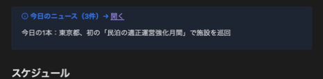
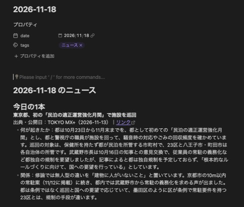

# obsidian-daily-news

Obsidian の日記から「いま自分が何に時間を使っているか」を Claude が読み取り、それに関係するニュースを毎朝3〜5件探して、vault にノートとして置いてくれる Claude Code 用のスキルです。

関心のあるテーマを自分で登録する必要はありません。直近2週間の日記に何が何回出てきたかから、Claude が週1回テーマを作り直します。

## どう見えるか

作者の vault での実際の画面です。

**日記の予定の上に、1行のリンクが入ります**



**リンク先のニュースノート**（「今日の1本」と、それが自分の何に関係するか）



ノートの最後には「探したこと」（どのクエリで探して、何を外したか）と「本人メモ」欄があります。本人メモに「これ良かった」「いらない」と書いておくと、次回からのテーマ選びに反映されます。

## 何をするか

1. 直近14日の日記を読み、よく出てくるプロジェクト・予定から関心テーマを最大4つ作る（`daily-news_INTERESTS.md`。週1回作り直し）
2. テーマごとに Web 検索し、記事本体を開いて公開日と中身を確かめる
3. 7日以内の記事から3〜5件を選び、「何が起きたか」と「自分のどの作業に関係するか」を1文ずつ書く
4. `News/YYYY-MM-DD.md` に保存し、当日の日記に1行リンクを足す

公開日が確かめられない記事、自分との関係が1文で言えない記事は載せません。

## セットアップ

Claude Code にこのリポジトリの URL を渡して、こう頼んでください。

```
https://github.com/udontabetaikamo/obsidian-daily-news をセットアップして
```

Claude が [SETUP.md](SETUP.md) を読んで、次を順にやります。

1. vault の場所・日記フォルダ・ニュースの保存先をあなたに確認する
2. スキルを `~/.claude/skills/daily-news/` に置き、設定ファイルを埋める
3. **毎朝の定時実行（scheduled task）を登録する**（既定 6:30。要らなければ断れます）
4. その場で1回動かして、できたノートを見せる

以降は毎朝、何もしなくてもノートができます。会話の中で「今日のニュース」と打っても動きます。

### 必要なもの

- Claude Code（デスクトップアプリまたは CLI）と、Web 検索が使える環境
- Obsidian の日記（1日1ファイル、`YYYY-MM-DD.md` のような日付のファイル名）

## 作者の使い方について（注意書き）

作者は定時実行を使っていません。毎朝 Claude Code に「今日気をつけること」と打つのが日課で、そのときに過去の日記からの注意点（別のスキル）と一緒にこのニュースを更新しています。定時実行は、無人で動くぶん許可の確認で止まることがあり、作者の環境ではその調整より手で打つほうが合っていたためです。

このリポジトリのセットアップでは、手で打たなくても届くように定時実行を標準にしています。作者と同じく手で呼びたい人は、セットアップ時に「定時実行は要らない」と伝えてください。

## ファイル

```
skills/daily-news/SKILL.md          スキル本体（Claude が読む手順）
skills/daily-news/config.example.md 設定のひな形
SETUP.md                            Claude 向けのセットアップ手順
docs/                               README の画像
```

## License

MIT
